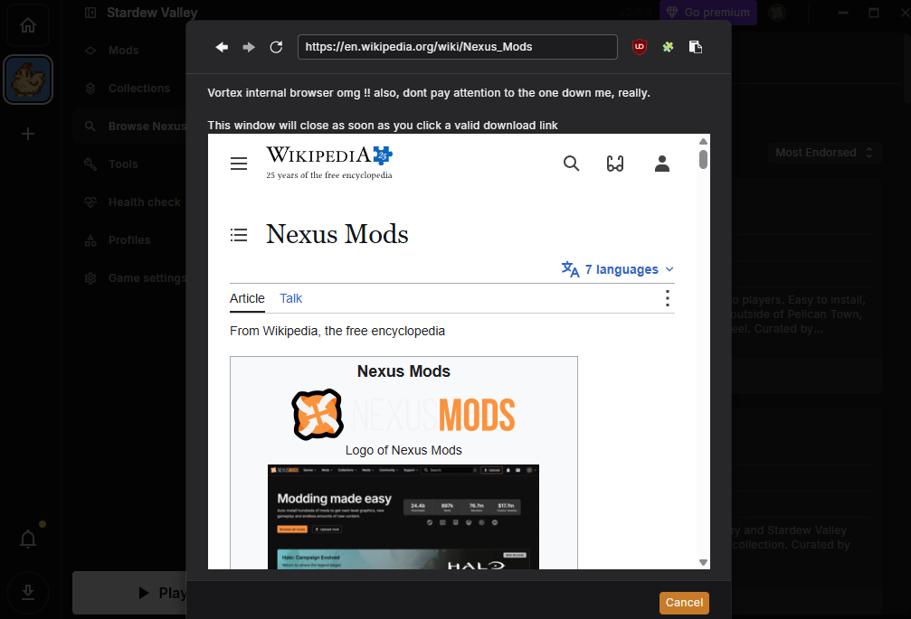
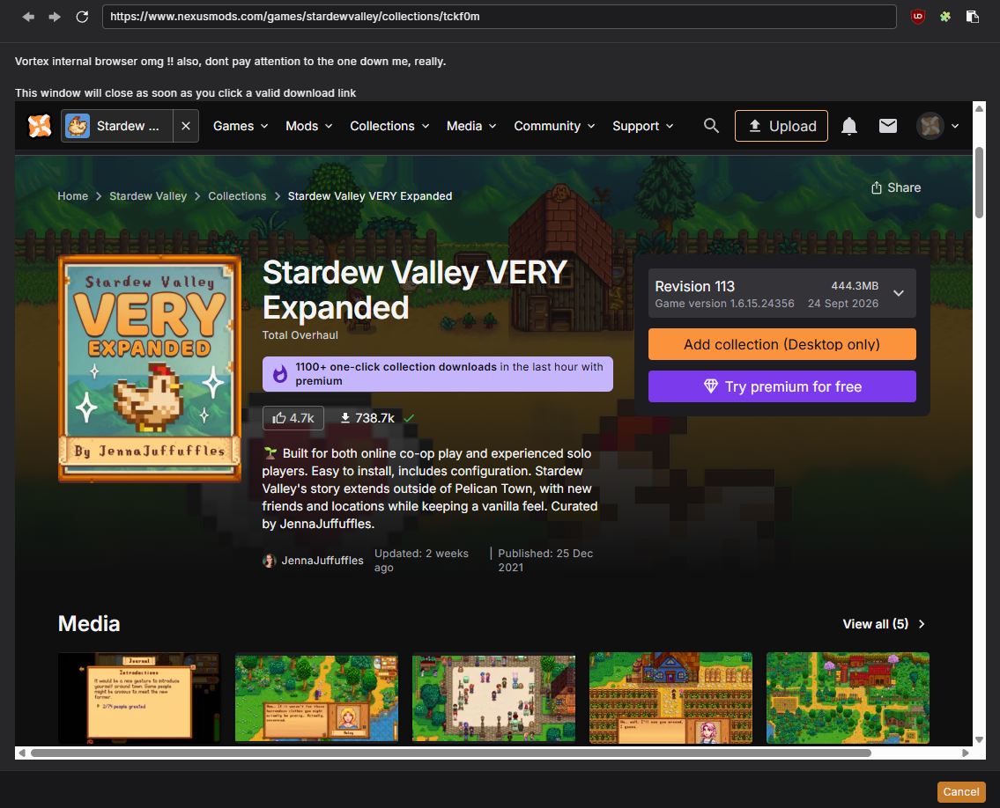
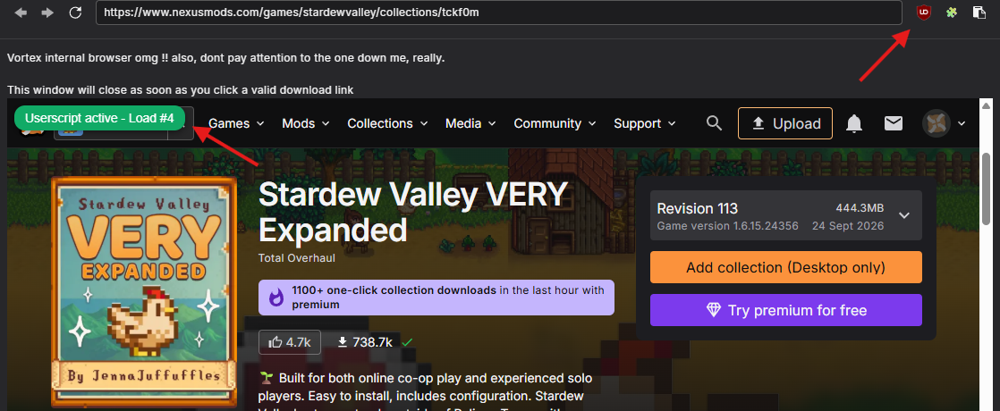

# VortexFix: custom patch for Vortex
Fix for Nexus Mods client Vortex, unlocking the **internal web browser** and it features.
It also has support to install **extensions and execute scripts** inside the web browser.



> **VortexFix** modifies Vortex application files and **may stop working** after a client update. Use it at your own risk.

# Features
- **Built-in browser** — Browse Nexus Mods collection pages directly inside Vortex.
- **Extension support** — Load browser extensions from a dedicated directory.
- *User scripts** — Execute custom JavaScript files in the internal browser.
- **Easy setup** — Apply the patch using a standalone Node.js script.

---

# Requirements
The requirements are simple, as you only need to apply a patch to the Electron code:

- Nexus Mods [Vortex client](https://www.nexusmods.com/vortex) version v2.8.0.
- [NodeJS](https://nodejs.org/en/download)_(tested on **v26.11.1**)_.

---

# Installing

1. First you need to run the patcher:
```sh
node patch-vortex.js "C:\Program Files\Vortex\resources\app.asar"
```
_(Check your Vortex path before running this, maybe its on a different folder)._

2. Run Vortex.
3. Go to the game you want, select "Browse Nexus Mods" and inside the "colletions" tab, use the "View Page".


4. Now you can browse the collections website using the browser built into Vortex.



5. _(Optional)_ This patch has support for extensions and running scripts on the browser:
- **Extensions**: You need to make a folder inside `**%APPDATA%\Vortex\browser-extensions\**` (created the first time you run the patch).
- **Scripts**: You need to add a .js script inside `**%APPDATA%\Vortex\userscripts\**` (created the first time you run the patch).



---

# Disclaimer

> **VortexFix** is an **unofficial community project**. It is not affiliated with, endorsed by, or supported by Nexus Mods. All product names and trademarks belong to their respective owners.


## License

[MIT](LICENSE)